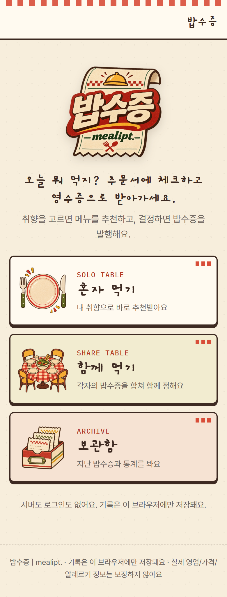
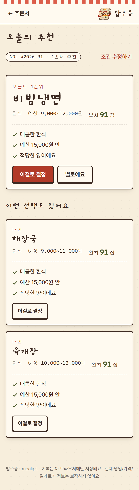
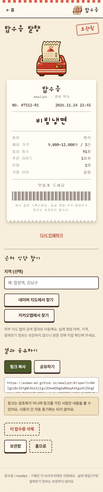
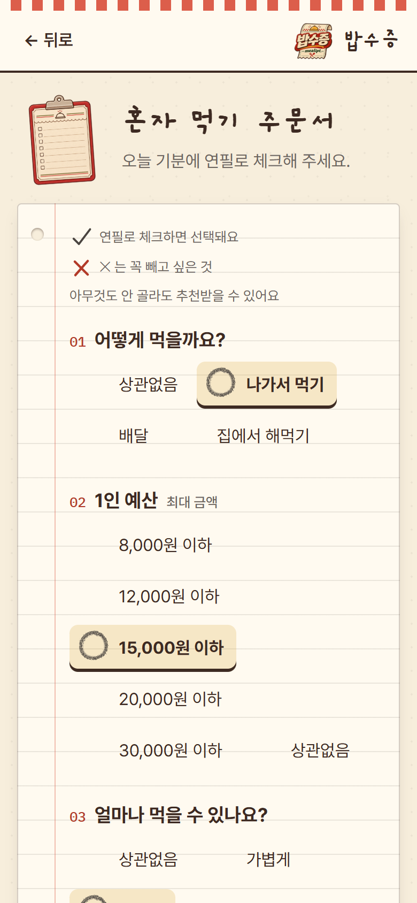
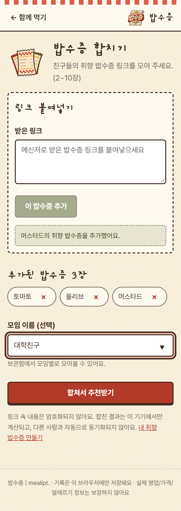
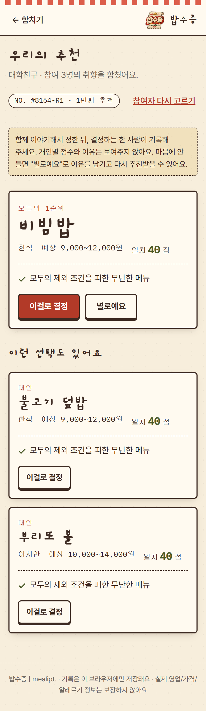
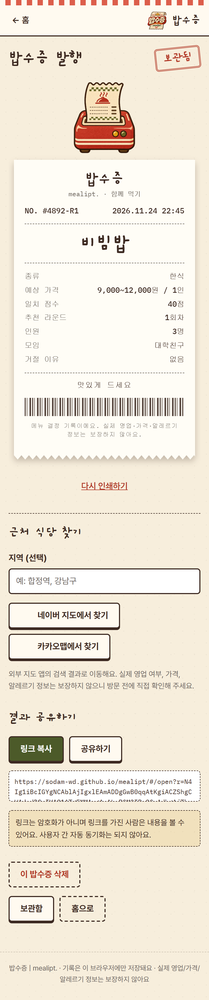
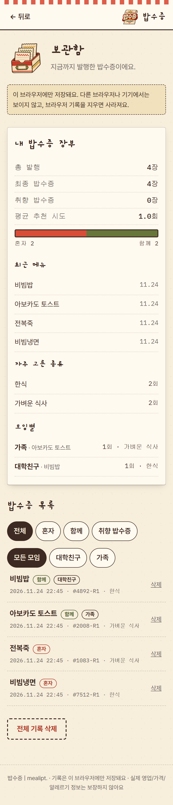

<p align="center">
  
</p>

# 밥수증 | mealipt.

종이 주문서에 연필로 체크하듯 취향을 고르고, 영수증처럼 오늘의 메뉴를 발행하는 메뉴 결정 웹앱입니다.
서버도 로그인도 없이, 브라우저에서만 동작합니다.

**실행 링크: <https://sodam-wd.github.io/mealipt/>**

<p align="center">
  
  
  
</p>

## 핵심 기능

- **주문서형 취향 입력**: 식사 방식, 예산, 얼마나 먹을 수 있는지, 끌리는 종류, 원하는 맛을 체크하고, 꼭 빼고 싶은 재료는 `✕` 로 표시합니다. 아무것도 고르지 않아도 추천받을 수 있습니다.
- **거절 이유를 반영한 재추천**: `별로예요` 를 누르고 이유(너무 매워요, 너무 느끼해요 등)를 고르면 다음 추천에 반영됩니다. 거절한 메뉴는 다시 나오지 않습니다.
- **밥수증 발행과 보관**: 결정하면 영수증 형태의 밥수증이 발행되고 이 브라우저의 보관함에 저장됩니다.
- **취향 밥수증 공유**: 각자 자기 폰에서 취향 밥수증을 발행하고, 링크를 메신저로 보냅니다.
- **밥수증 합치기와 공동 추천**: 2~10장의 취향 밥수증 링크를 붙여넣으면 모두의 필수 제외 재료를 지키면서 공동 추천을 계산합니다. 합치는 순서를 바꿔도 결과는 같고, 개인별 점수와 이유는 보여주지 않습니다.
- **공동 결과 링크**: 공동 최종 밥수증도 링크로 공유하고, 받은 사람은 열어 보고 보관함에 저장할 수 있습니다.
- **보관함과 기본 통계**: 혼자/함께/취향 밥수증 필터, 모임 이름별 모아보기와 통계(총 발행 수, 혼자/함께 비율, 최근 메뉴, 자주 고른 종류), 개별 삭제와 전체 삭제.
- **근처 식당 찾기**: 최종 밥수증의 메뉴 이름으로 네이버 지도/카카오맵 검색 페이지를 새 탭으로 엽니다.
- **작성 중인 주문서 자동 저장**: 새로고침해도 이어서 쓸 수 있습니다.
- 메뉴 150종(한식, 중식, 일식, 양식, 분식, 아시안, 패스트푸드, 가벼운 식사)이 내장되어 있습니다.

## 화면

| 혼자 먹기 주문서 | 밥수증 합치기 | 공동 추천 |
|---|---|---|
|  |  |  |

| 공동 최종 밥수증 | 보관함과 통계 |
|---|---|
|  |  |

화면 속 닉네임(토마토, 올리브, 머스타드)은 예시용 가상 이름입니다.

## 사용 방법

### 혼자 먹기
1. 홈에서 `혼자 먹기` 를 누릅니다.
2. 주문서에 취향을 체크하고 `추천받기` 를 누릅니다.
3. 추천이 마음에 들지 않으면 `별로예요` 로 이유를 고르고 다시 추천받습니다. 아래의 대안 메뉴를 바로 고를 수도 있습니다.
4. `이걸로 결정` 을 누르면 밥수증이 발행되고 보관함에 저장됩니다. 결과 링크 복사와 근처 식당 찾기를 쓸 수 있습니다.

### 함께 먹기
1. 모임의 각 사람이 자기 폰에서 `함께 먹기` → `내 취향 밥수증` 으로 취향 밥수증을 발행하고 링크를 모임 채팅방에 올립니다.
2. 한 사람이 `밥수증 합치기` 화면에서 받은 링크들을 하나씩 붙여넣어 2~10장을 모읍니다. 메신저 메시지 전체를 붙여넣어도 링크를 찾아 추가합니다.
3. 모임 이름(예: 대학친구, 가족)을 적으면 보관함에서 모임별로 모아볼 수 있습니다.
4. `합쳐서 추천받기` 로 공동 추천을 확인합니다. 의견은 대화로 합의하고, 결정하는 한 사람이 `이걸로 결정` 으로 기록합니다.
5. 공동 최종 밥수증 링크를 공유하면 다른 사람은 링크를 열어 내용을 보고 자기 보관함에 저장할 수 있습니다.

### 보관함
- 홈의 `보관함` 에서 발행한 밥수증, 통계, 모임별 기록을 봅니다.
- 밥수증 하나만 지우거나, `전체 기록 삭제` 로 이 브라우저의 모든 기록과 작성 중인 작업을 지울 수 있습니다.

## 지원 환경

- 직접 확인한 환경: Windows 의 **Google Chrome 157**, **Microsoft Edge 158** (모바일 폭 320 / 375 / 390 / 768 px 과 데스크톱 1280 px 에뮬레이션, 키보드 조작, 움직임 줄이기 설정 포함).
- 서로 다른 브라우저(Chrome ↔ Edge) 사이의 링크 교환을 확인했습니다.
- Safari, Firefox, 실제 모바일 기기는 아직 직접 확인하지 않았습니다.

## 데이터와 개인정보

- 데이터는 **브라우저의 LocalStorage** 에만 저장됩니다. 서버, 로그인, 계정, 추적, 분석 도구가 없습니다.
- 다른 브라우저나 다른 기기에서는 기록이 보이지 않습니다. 브라우저의 사이트 데이터를 지우거나 시크릿 모드를 쓰면 기록이 사라질 수 있습니다. 보관함은 공유 링크로 따로 보관해 주세요.
- **공유 링크는 암호화가 아닙니다.** 링크 안에 취향(또는 결과) 내용이 압축되어 들어 있어서, 링크를 가진 사람은 누구나 내용을 볼 수 있습니다. 민감한 정보는 닉네임에 쓰지 마세요.
- 사용자 간 **자동 동기화는 없습니다.** 합치기는 링크를 받은 사람의 기기에서만 계산됩니다.
- 외부 통신은 사용자가 직접 누른 지도 검색 링크(네이버 지도, 카카오맵)뿐입니다. 지도 API 키나 SDK는 쓰지 않으며, 링크를 누르기 전에는 외부 요청이 발생하지 않습니다.

## 알려진 제한

- 메뉴의 가격과 재료는 대략적인 **추정치**입니다. 실제와 다를 수 있습니다.
- 재료 제외 기능은 추천에서 해당 재료가 들어간 메뉴를 빼는 편의 기능이며, **알레르기 안전을 보장하지 않습니다.** 알레르기가 있다면 반드시 식당에 직접 확인하세요.
- 근처 식당 찾기는 외부 지도 검색으로 연결할 뿐이며, 실제 영업 여부, 가격, 메뉴 정보를 보장하지 않습니다.
- 공유 링크가 매우 길거나 손상되었거나 다른 버전에서 만든 경우 열 수 없습니다. 이때는 보낸 사람에게 링크를 다시 만들어 달라고 요청하세요.
- 링크 길이 제한상 한 번에 합칠 수 있는 밥수증은 최대 10장입니다.

## 개발

필요 환경: Node.js 24 (LTS) 이상 권장, npm.

```bash
npm ci            # 의존성 설치
npm run dev       # 개발 서버
npm run typecheck # 타입 검사
npm run build     # 정적 빌드 (dist/)
npm run preview   # 빌드 결과 미리보기
```

- 스택: React, TypeScript, Vite, react-router (HashRouter), lz-string.
- 해시 라우팅과 상대 경로 `base` 를 사용하므로 GitHub Pages 의 하위 경로(`/<저장소 이름>/`)에서 새로고침해도 동작합니다.
- 배포: `main` 브랜치에 push 하면 GitHub Actions 워크플로(`.github/workflows/deploy.yml`)가 설치, 타입 검사, 빌드를 거쳐 GitHub Pages 로 배포합니다. 저장소 설정의 Pages 소스는 `GitHub Actions` 로 지정해야 합니다.

## 라이선스

- 코드: [MIT](./LICENSE)
- 글꼴: Pretendard, Gaegu, IBM Plex Mono 는 각각 SIL Open Font License 1.1 입니다. 라이선스 전문은 [`public/licenses/`](./public/licenses/) 에 있습니다.
- 이미지 자산(`public/assets/`): 이 프로젝트를 위해 AI 이미지 생성 도구(ChatGPT 이미지 생성)로 만든 이미지입니다. 저장소에 포함된 파일은 크기를 줄인 버전이며 C2PA 콘텐츠 자격 증명 메타데이터는 포함되어 있지 않습니다.
